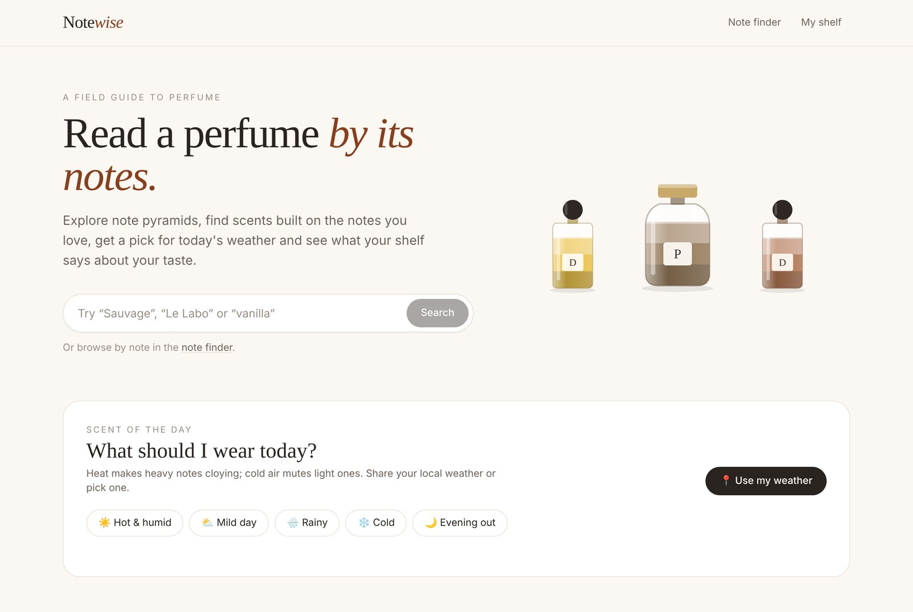
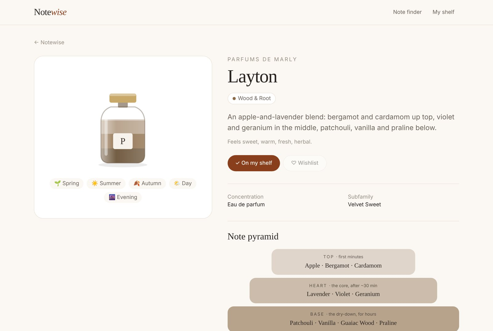
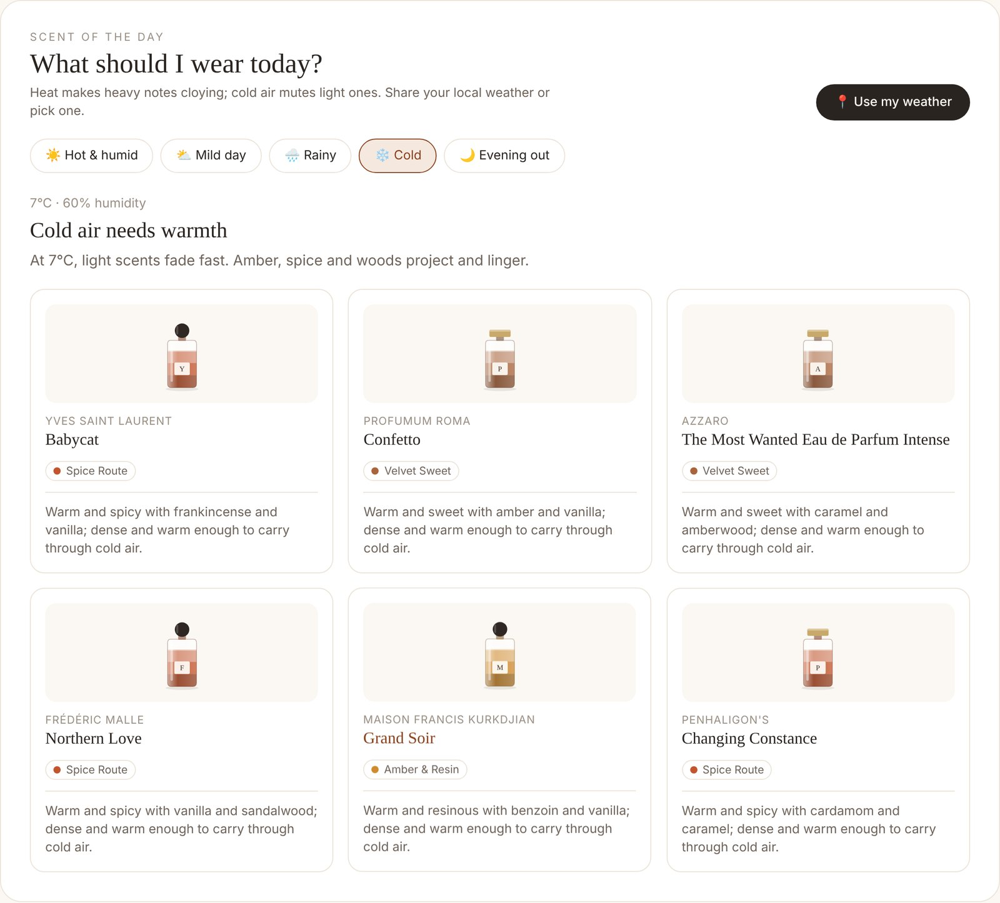
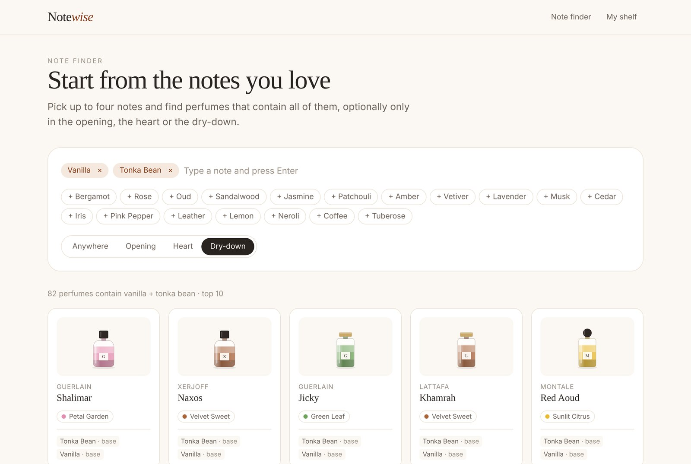
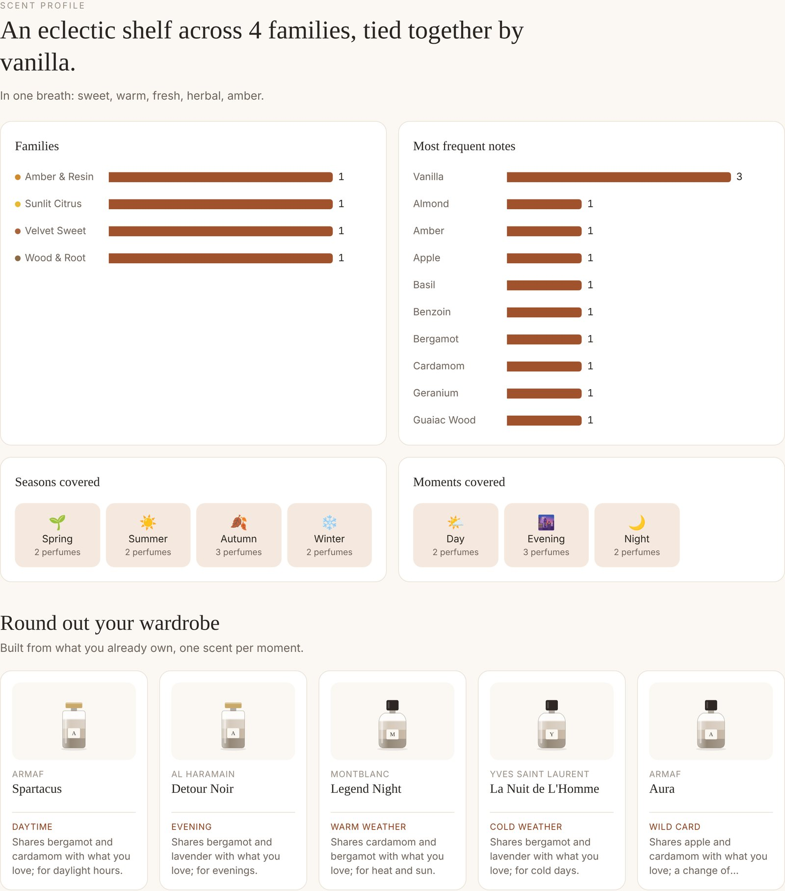
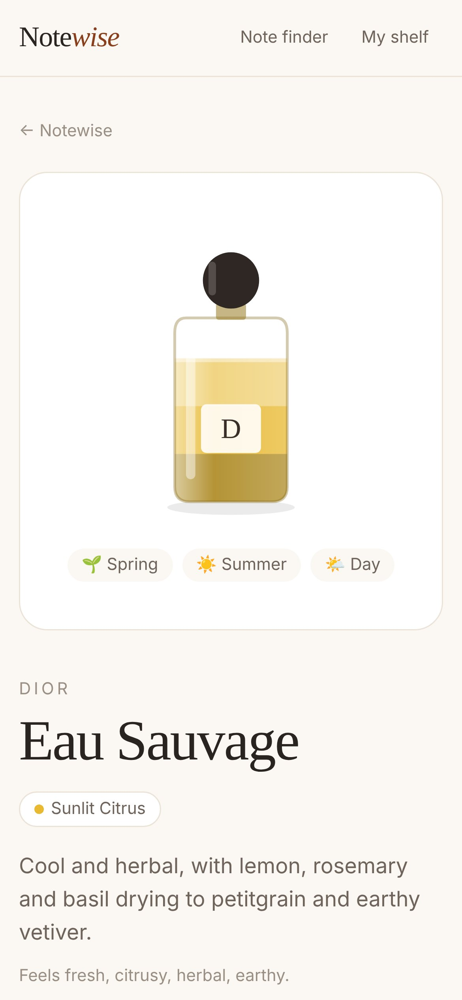
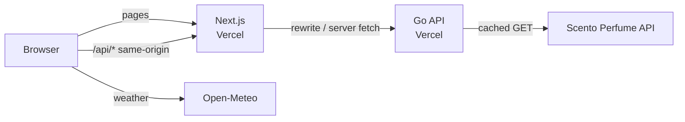
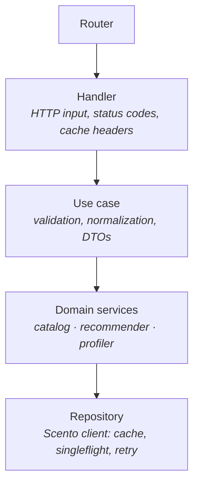

# Notewise

> **Read a perfume by its notes.** Explore note pyramids, find scents built on the notes you love, get a pick for today's weather and see what your shelf says about your taste.


### 🔗 Live demo: **[notewise-perfumes.vercel.app](https://notewise-perfumes.vercel.app)**



---

## 📌 The problem

Perfume descriptions are vague ("fresh", "seductive", "unique"). What actually tells you whether you'll like a fragrance is its **notes**: the ingredients that open it (top), carry it (heart) and linger for hours (base). But notes are scattered across retail pages, and the questions people really ask are harder:

- *"I love vanilla and tonka — what else is built on them?"*
- *"It's 31°C and humid. What should I wear?"*
- *"What does my collection say about my taste, and what's missing?"*

## 🧠 The solution

Notewise is a **Go API + Next.js** app that turns a free perfume database into answers to those questions:

| Feature | What it does |
|---|---|
| 🔎 **Search** | Find perfumes by name, house, note or mood word |
| 🧪 **Perfume page** | Note pyramid, character, seasons and moments, and **similar perfumes with the notes they share** |
| 🎯 **Note finder** | Pick up to 4 notes and filter by where they sit in the pyramid (opening, heart, dry-down) |
| 🌦️ **Scent of the day** | Reads your local weather and recommends perfumes that work in it |
| 🗂️ **My shelf** | Save what you own (in the browser, no account) and get your **scent profile**: families, recurring notes, seasons covered, gaps and suggestions |

Every bottle is an **SVG illustration generated from the data**: the liquid takes the color of the olfactory family, in three layers (top, heart, base), and the silhouette changes with the concentration. No product photos, so no image-rights issues, and every perfume gets a consistent look.

## 📸 Screenshots

| Perfume page | Scent of the day |
|---|---|
|  |  |

| Note finder | Scent profile |
|---|---|
|  |  |

<p align="center"></p>

## 🏗️ Architecture



- **The browser never calls the Go API directly.** Next.js proxies `/api/*` to it (a rewrite), so there is no CORS setup and the API URL is not shipped to the client.
- **Weather is fetched by the browser on purpose.** Open-Meteo's free tier is limited per IP: calling it from a shared server would burn one quota for everyone, while each visitor has their own.
- **The Go API is the only thing talking to Scento**, and it adds what a raw proxy can't: caching, request coalescing, validation, error mapping and the business rules below.

### Go API — layered design

The API follows a layered architecture: each layer has one job and depends on the next one only through an interface.



```
api/
  cmd/api/                       composition root (wires dependencies only)
  internal/
    app/perfume/
      controller/
        router.go                routes
        handler/                 HTTP ⇄ use cases, error → status mapping
        usecase/                 validation + orchestration
        dto/                     public API contracts
      domain/
        model/                   entities, ids, domain errors
        service/                 business rules (catalog, recommender, profiler)
      repository/scento/         Scento client + mapper (+ real-response fixtures)
    crosscutting/
      cache/                     generic TTL cache with singleflight
      config/  logger/  httpx/   env config, slog JSON logs, middleware
web/
  app/                           pages (App Router)
  components/                    Bottle (SVG), Pyramid, charts, cards…
  lib/                           API client, shelf storage, family colors
```

### Decisions worth explaining

**1. Two cache layers, because the provider asks for it.** Scento's terms ask clients to *cache answers and keep request rates reasonable*. Responses are cached in memory per instance (a generic `TTL[V]` cache) **and** at Vercel's CDN through `Cache-Control: s-maxage` headers. Identical concurrent requests are collapsed into one upstream call with `singleflight`. A repeated perfume lookup went from **~75 ms to under 1 ms** in local tests.

**2. Graceful degradation.** A perfume page loads the profile and the similar perfumes **concurrently** (`errgroup`). The profile is required; neighbours are a nice-to-have, so if that call fails the page is still served without them.

**3. Bounded concurrency.** Profiling a shelf of 30 perfumes means 30 lookups. They run in parallel but with **at most 5 in flight** (`errgroup.SetLimit`), so one user can't hammer the provider.

**4. The provider's quirks stay in the repository.** Scento answers *"not found"* with HTTP 200 and `found: false`, some perfumes have a pyramid while others have a flat list, and some names carry artefacts like a trailing `" :"`. The repository maps all of that into a clean domain model and real errors (`404`), so the rest of the code never sees it.

**5. Weather → perfume rules as data.** Heat and humidity make heavy, sweet notes cloying; cold air mutes light ones. `Classify()` turns temperature, humidity, day/night and the WMO weather code into an occasion and family preferences, and `Rank()` reorders the provider's picks with a stable sort. Both are pure functions with table-driven tests.

**6. Errors never leak internals.** Domain errors map to `400 / 404 / 502 / 504`; 5xx responses return a friendly message while the details go to structured logs.

## 🧰 Tech stack

- **Backend:** Go 1.24 — `net/http` (method routing), `log/slog`, generics, `errgroup`, `singleflight`
- **Frontend:** Next.js 15 (App Router, server components), React 19, TypeScript, Tailwind CSS
- **Data:** [Scento Perfume API](https://www.scento.com/developers/perfume-api) (free, keyless) · [Open-Meteo](https://open-meteo.com) (weather)
- **Hosting:** Vercel (two projects from one repository)

## 🧪 Tests

```bash
cd api && go test -race ./...
```

| Layer | What is tested |
|---|---|
| Repository | Mapping of **real API responses** captured as fixtures, not-found handling, caching, retry on 5xx, no retry/caching of 4xx |
| Cache | Expiry, bounded size, errors never cached, 50 concurrent loads → 1 call |
| Services | Weather classification table, ranking, page served when neighbours fail, profile aggregation, bounded concurrency, missing perfumes |
| Use cases | Input validation and normalization (ids, notes, weather ranges, collection size) |
| Handlers | Error → status mapping, cache headers, query/body parsing, no leaking of internal errors |

## ▶️ Run locally

Prerequisites: [Go 1.24+](https://go.dev/dl/) and [Node.js 20+](https://nodejs.org).

**1. Clone**

```bash
git clone https://github.com/victorhisamitsu/notewise.git
cd notewise
```

**2. Start the API** (port 8080)

```bash
cd api
go run ./cmd/api
```

**3. Start the web app** (in another terminal, port 3000)

```bash
cd web
npm install
npm run dev
```

Open http://localhost:3000. No keys or accounts are needed: both data sources are free and keyless.

**Try the API directly**

```bash
curl "localhost:8080/api/v1/perfumes/search?q=sauvage"
curl "localhost:8080/api/v1/perfumes/eau-sauvage-dior"
curl "localhost:8080/api/v1/notes/match?notes=vanilla,tonka%20bean&tier=base"
curl "localhost:8080/api/v1/recommendations/today?temp=31&humidity=80&code=1&isDay=true"
curl -X POST localhost:8080/api/v1/collection/profile -d '{"perfumeIds":["eau-sauvage-dior","layton-parfums-de-marly"]}'
```

| Method | Path | Description |
|---|---|---|
| GET | `/api/v1/perfumes/search?q=` | Search perfumes |
| GET | `/api/v1/perfumes/{id}` | Perfume profile + similar perfumes |
| GET | `/api/v1/notes/match?notes=&tier=` | Perfumes containing all the notes (`tier`: any, top, heart, base) |
| GET | `/api/v1/families` | The 14 olfactory families |
| GET | `/api/v1/recommendations/today?temp=&humidity=&code=&isDay=` | Weather-based picks |
| POST | `/api/v1/collection/profile` | Scent profile of a shelf (`{"perfumeIds": [...]}`, max 30) |
| GET | `/api/health` | Health check |

## 🚀 Deploy on Vercel

Live at **[notewise-perfumes.vercel.app](https://notewise-perfumes.vercel.app)**, with the API at `notewise-api.vercel.app`. The repository deploys as **two Vercel projects**, both free on the Hobby plan.

**1. The API**
1. On Vercel, **Add New → Project** and import this repository.
2. **Root Directory:** `api` · **Framework Preset:** `Go`.
3. Deploy, then check `https://<your-api>.vercel.app/api/health` returns `{"status":"ok"}` and copy the URL.

**2. The web app**
1. Import the same repository again as a second project.
2. **Root Directory:** `web` · **Framework Preset:** `Next.js`.
3. **Environment variable:** `API_URL` = the API URL from step 1 (no trailing slash).
4. Deploy.
5. **Settings → Domains → Add Existing** and pick a public `*.vercel.app` name for production. The automatic `-git-main-` and hash URLs are behind Vercel's login (Standard Deployment Protection), so share the production domain.

## ⚖️ Trade-offs and limitations

- 🔴 **Catalog size.** Scento lists ~1,400 perfumes with notes traced to the brands' own published lists. Larger databases exist, but they need keys, paid plans or community-sourced data. I chose accuracy and zero friction for a public demo.
- 🔴 **The shelf lives in the browser.** No account means instant use, but the shelf doesn't sync across devices. Accounts and a database would be the next step.
- 🔴 **Per-instance memory cache.** Serverless instances don't share memory, so the CDN cache does most of the work. A shared cache (e.g. Redis) would help at higher traffic.
- 🔴 **Recommendation rules are heuristics.** The weather rules encode common perfumery advice, not personal taste. Combining them with the user's shelf profile would make them personal.

## 🙏 Credits

- Perfume data: **[Scento Perfume API, scento.com](https://www.scento.com/developers/perfume-api)**, used under its terms (cached, low request rate, attribution shown on every page).
- Weather: **[Open-Meteo](https://open-meteo.com)**.

---

Built by **Victor Hisamitsu** — Backend Software Engineer (Go).
[LinkedIn](https://www.linkedin.com/in/victor-hisamitsu-1b985a237/) · [GitHub](https://github.com/victorhisamitsu)
